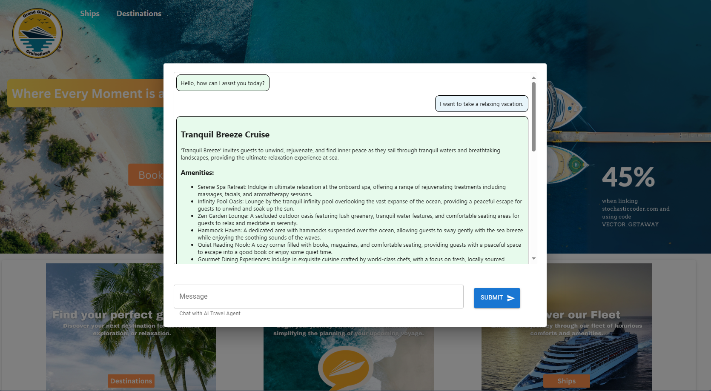
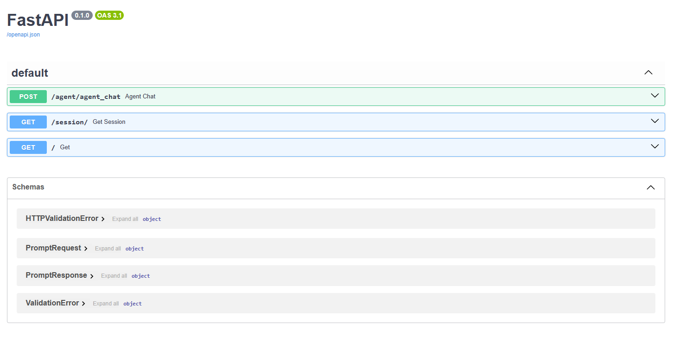
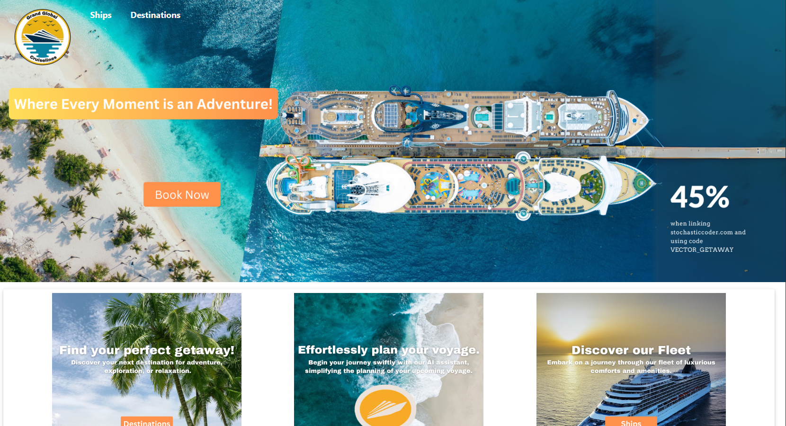

# AtlasMind AI – Intelligent Cruise Travel Agent

**A conversational AI travel agent that searches cruise ships, explores itineraries, and handles bookings. Built with LangChain, FastAPI, React, and Azure Cosmos DB for MongoDB vCore as a vector store.**




---

## Overview

AtlasMind AI is a full-stack AI agent for a cruise travel company. Users chat with it in plain language ("I want a relaxing Caribbean cruise with a spa"), and it decides on its own which tools to use: it searches cruise ships by meaning with vector search, looks up a ship's packages, prices, and schedules, and walks the user through booking.

Unlike a basic RAG chatbot, AtlasMind AI is a **tool-using agent**. The LLM chooses between several specialized tools, combines their results, and remembers the conversation across turns. Each user's chat history is stored in Azure Cosmos DB.

---

## Key Features

- **Tool-using AI agent.** A LangChain OpenAI Tools agent picks the right tool for each request instead of following a fixed script.
- **Semantic ship search.** Cruise ship descriptions are embedded with OpenAI embeddings and searched by meaning in Cosmos DB's vector store, so "family-friendly with water slides" finds the right ships without exact keywords.
- **Itinerary lookup.** Retrieves cruise packages, room types and prices, and destination schedules for any ship.
- **Conversational booking.** Collects the passenger name and room choice step by step before confirming a booking *(simulated for demo purposes)*.
- **Persistent memory.** Each session's conversation is stored in Cosmos DB, so the agent remembers earlier context.
- **React chat interface.** A Material UI front end for chatting with the agent and browsing ships and destinations.
- **Documented REST API.** A FastAPI backend with interactive Swagger docs.

---

## Agent Tools

| Tool | What it does | Data source |
|---|---|---|
| `vacation_lookup` | Finds cruise ships that match a description, using vector similarity search | `travel.ships` (vector store) |
| `itinerary_lookup` | Returns packages, room prices, and schedules for a given ship | `travel.itinerary` |
| `book_cruise` | Books a package for a passenger and room, asking for any missing details first | Simulated (demo) |

---

## Architecture

```text
┌──────────────────┐     POST /agent/agent_chat      ┌──────────────────────────────┐
│  React frontend  │ ──────────────────────────────► │       FastAPI backend        │
│  (web/)          │ ◄────────────────────────────── │       (api/)                 │
└──────────────────┘        HTML-formatted answer    │                              │
                                                     │  LangChain OpenAI Tools Agent│
                                                     │   ├─ vacation_lookup ────────┼──┐
                                                     │   ├─ itinerary_lookup ───────┼──┤
                                                     │   └─ book_cruise             │  │
                                                     │  GPT-3.5-turbo-16k           │  │
                                                     └──────────────┬───────────────┘  │
                                                         chat history│                  │ vector / document search
                                                                     ▼                  ▼
                                                     ┌──────────────────────────────────────┐
                                                     │ Azure Cosmos DB for MongoDB vCore    │
                                                     │  travel.ships       (vector store)   │
                                                     │  travel.itinerary                    │
                                                     │  travel.destinations                 │
                                                     │  travel.history     (chat memory)    │
                                                     └──────────────────────────────────────┘
                                                                     ▲
                                                     ┌───────────────┴──────────────┐
                                                     │ Data loader (loader/)        │
                                                     │ JSON → OpenAI embeddings     │
                                                     └──────────────────────────────┘
```

---

## Technology Stack

| Layer | Technology |
|---|---|
| Frontend | React 18, Material UI, React Router |
| Backend | Python 3.11, FastAPI, Uvicorn |
| AI framework | LangChain (OpenAI Tools Agent, `RunnableWithMessageHistory`) |
| Language model | OpenAI `gpt-3.5-turbo-16k` |
| Embeddings | OpenAI Embeddings |
| Database and vector store | Azure Cosmos DB for MongoDB vCore |
| Chat memory | `MongoDBChatMessageHistory` |

---

## Project Structure

```text
atlasmind-ai/
├── loader/                     # Step 1: load sample data into Cosmos DB
│   ├── main.py                 # Entry point: loads ships, destinations, itineraries
│   ├── cosmosdbloader.py       # Creates embeddings and the vector store
│   ├── itinerarybuilder.py     # Builds cruise itineraries
│   ├── jsondataloader.py       # Reads the JSON source files
│   └── documents/              # ships.json, destinations.json
├── api/                        # Step 2: FastAPI and LangChain agent
│   ├── app.py                  # FastAPI app entry point
│   ├── service/
│   │   ├── init.py             # LLM, prompt, agent, and chat-history setup
│   │   ├── TravelAgent.py      # Runs the agent for a session
│   │   └── TravelAgentTools.py # vacation_lookup, itinerary_lookup, book_cruise
│   ├── data/mongodb/           # Vector search and itinerary queries
│   ├── model/                  # Pydantic models
│   └── web/                    # API routes (/agent, /session)
├── web/                        # Step 3: React frontend
│   └── src/
│       ├── Main.js             # Landing page
│       └── TripPlanning/       # Chat UI components
└── images/                     # Screenshots
```

---

## Getting Started

### Prerequisites

- **Python 3.11**
- **Node.js 20+** and npm
- An **Azure subscription** with an **Azure Cosmos DB for MongoDB vCore** cluster (the free tier works)
- An **OpenAI API key**

### 1. Clone the repository

```bash
git clone https://github.com/zaynnmotiwala/atlasmind-ai.git
cd atlasmind-ai
```

### 2. Load the travel data into Cosmos DB

```bash
cd loader
python -m venv venv
venv\Scripts\activate          # macOS/Linux: source venv/bin/activate
pip install -r requirements.txt
```

Create `loader/.env`:

```env
OPENAI_API_KEY=your_openai_api_key
MONGO_CONNECTION_STRING=your_cosmos_db_connection_string
```

Load the data (this creates embeddings and fills the `travel` database):

```bash
python main.py
```

You should now see the `destinations`, `itinerary`, and `ships` collections in your database:


### 3. Start the backend

```bash
cd ../api
python -m venv venv
venv\Scripts\activate          # macOS/Linux: source venv/bin/activate
pip install -r requirements.txt
```

Create `api/.env`:

```env
OPENAI_API_KEY=your_openai_api_key
MONGO_CONNECTION_STRING=your_cosmos_db_connection_string
```

Run the API:

```bash
python app.py
```

The API runs at **http://127.0.0.1:8000**, with interactive docs at **http://127.0.0.1:8000/docs**.



### 4. Start the frontend

```bash
cd ../web
```

Create `web/.env`:

```env
REACT_APP_API_HOST=http://127.0.0.1:8000
```

Install and run:

```bash
npm ci
npm start
```

The app opens at **http://localhost:3000**.



---

## Environment Variables

| Variable | Used in | Description |
|---|---|---|
| `OPENAI_API_KEY` | `loader/`, `api/` | OpenAI key for the chat model and embeddings |
| `MONGO_CONNECTION_STRING` | `loader/`, `api/` | Azure Cosmos DB for MongoDB vCore connection string |
| `REACT_APP_API_HOST` | `web/` | URL of the FastAPI backend |

> Never commit `.env` files. Keep them out of version control with `.gitignore`.

---

## API Reference

| Method | Endpoint | Description |
|---|---|---|
| `GET` | `/session/` | Creates a new chat session and returns a `session_id` |
| `POST` | `/agent/agent_chat` | Sends a message to the agent and returns its answer |
| `GET` | `/` | Health check (returns `"running"`) |

**Example request:**

```bash
curl -X POST http://127.0.0.1:8000/agent/agent_chat \
  -H "Content-Type: application/json" \
  -d '{"input": "Which cruise ships have a spa?", "session_id": "abc123"}'
```

**Example response:**

```json
{
  "text": "<p>Here are some cruise ships with spa facilities...</p>",
  "ResponseSeconds": 3.42
}
```

---

## How It Works

1. **Data loading.** The loader reads cruise ships and destinations from JSON, builds itineraries, embeds ship descriptions with OpenAI, and stores everything in Cosmos DB.
2. **Session start.** The frontend calls `GET /session/` to get a unique `session_id`.
3. **User message.** The user's question is sent to `POST /agent/agent_chat` with the session ID.
4. **Memory.** Earlier messages for that session are loaded from Cosmos DB.
5. **Agent reasoning.** The LangChain agent decides which tools to call, if any:
   - a general request such as "relaxing cruise" calls `vacation_lookup` (vector search),
   - "what does Ship X offer?" calls `itinerary_lookup`,
   - "book it for me" calls `book_cruise`, after asking for the passenger name and room.
6. **Response.** The LLM combines the tool results into an HTML-formatted answer, which the React UI renders.
7. **History saved.** The new exchange is saved to Cosmos DB for the next turn.

---

## Example Conversation

> **User:** I'm looking for a cruise with great entertainment and kids' activities.
> **AtlasMind AI:** *(calls `vacation_lookup`)* Here are three ships that fit…
>
> **User:** What packages does the first one have?
> **AtlasMind AI:** *(calls `itinerary_lookup`)* It offers a 7-night Caribbean package with these room prices…
>
> **User:** Book the balcony room.
> **AtlasMind AI:** To book a cruise, I'll need your name first.

---

## Limitations

- **Bookings are simulated.** `book_cruise` returns a demo confirmation and does not connect to a real reservation system.
- **Sample data.** Ships, destinations, and itineraries are sample data for demonstration.
- **No authentication.** The API is open and CORS allows all origins. Add authentication and restrict CORS before any public deployment.
- **Model choice.** Uses `gpt-3.5-turbo-16k`. You can switch to a newer OpenAI model in `api/service/init.py`.

---

## Future Improvements

- Integrate a real booking and payment system.
- Stream responses token by token.
- Add user accounts and saved trip plans.
- Upgrade to a newer model and add evaluation tests for agent tool selection.
- Containerize with Docker and deploy to Azure App Service.
